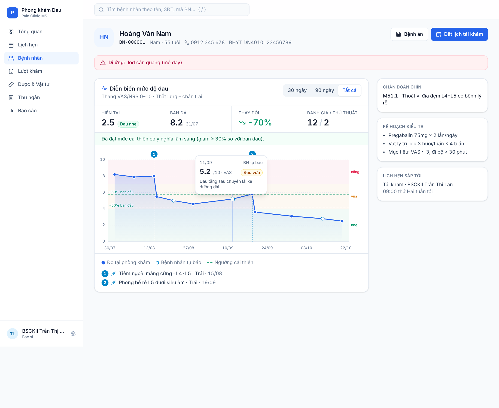
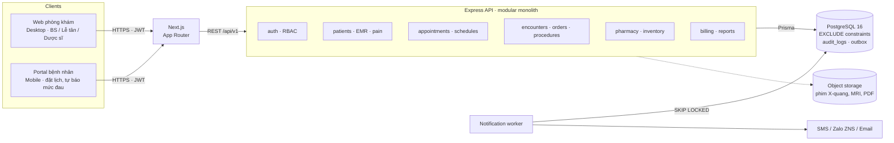
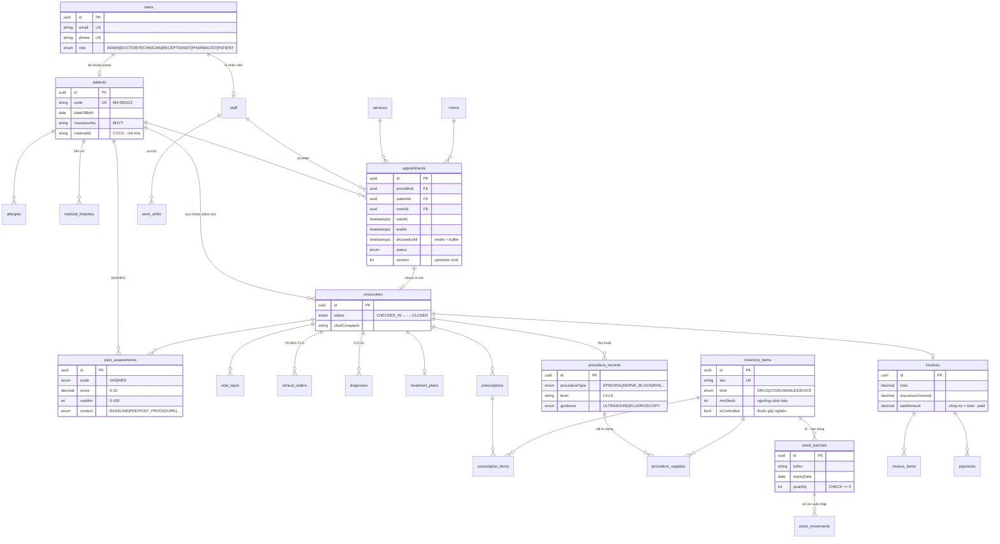
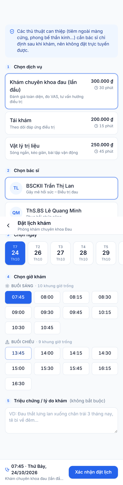

# Pain Clinic Management System — Hệ thống Quản lý Phòng khám Đau

Bộ khung (boilerplate) cho phần mềm quản lý phòng khám chuyên khoa điều trị đau: hồ sơ bệnh án điện tử (EMR) với thang điểm VAS/NRS, đặt lịch có chống trùng lịch nhiều lớp, quy trình khám khép kín, kho dược – vật tư, thu ngân và phân quyền RBAC.

| Tầng | Công nghệ |
|---|---|
| Frontend | Next.js 15 (App Router) · React 19 · Tailwind CSS v4 · lucide-react |
| Backend | Node.js 20+ · Express 5 · TypeScript · Zod |
| CSDL | PostgreSQL 16 · Prisma ORM 6 |
| Hạ tầng | Docker Compose (Postgres) · worker gửi thông báo (Transactional Outbox) |



---

## Mục lục

1. [Kiến trúc hệ thống](#1-kiến-trúc-hệ-thống)
2. [Sơ đồ ERD cơ sở dữ liệu](#2-sơ-đồ-erd-cơ-sở-dữ-liệu)
3. [Quy trình khám chữa bệnh khép kín](#3-quy-trình-khám-chữa-bệnh-khép-kín)
4. [Chống trùng lịch — 3 lớp phòng thủ](#4-chống-trùng-lịch--3-lớp-phòng-thủ)
5. [Phân quyền RBAC](#5-phân-quyền-rbac)
6. [Cấu trúc thư mục](#6-cấu-trúc-thư-mục)
7. [Hướng dẫn cài đặt & chạy](#7-hướng-dẫn-cài-đặt--chạy)
8. [API mẫu](#8-api-mẫu)
9. [Bảo mật & tuân thủ dữ liệu y tế](#9-bảo-mật--tuân-thủ-dữ-liệu-y-tế)
10. [Lộ trình phát triển tiếp](#10-lộ-trình-phát-triển-tiếp)

---

## 1. Kiến trúc hệ thống

**Modular monolith** — một backend chia module theo nghiệp vụ, một CSDL. Với quy mô một (hoặc vài) phòng khám, kiến trúc này đơn giản để vận hành, giao dịch ACID xuyên module (vd: kê đơn → trừ kho → thêm dòng hóa đơn trong *một* transaction), và vẫn tách được thành service riêng sau này vì ranh giới module đã rõ.



Nguyên tắc chung:

- **Mỗi module** gồm `*.routes.ts` (HTTP + RBAC + validate), `*.schema.ts` (Zod), `*.service.ts` (nghiệp vụ, transaction). Logic thuần tách riêng để test đơn vị (vd: `scheduling.ts`).
- **Ghi nghiệp vụ + audit log + thông báo trong cùng một transaction.** Không gọi nhà mạng SMS trong request — ghi vào bảng `notification_outbox`, worker gửi sau.
- **Thời gian** lưu `timestamptz` (UTC), hiển thị theo `Asia/Ho_Chi_Minh`. API chỉ nhận ISO 8601 *có múi giờ*.
- **Tiền** dùng `Decimal(14,2)`, không dùng `float`.

## 2. Sơ đồ ERD cơ sở dữ liệu

Schema đầy đủ (≈ 25 bảng) ở [`backend/prisma/schema.prisma`](backend/prisma/schema.prisma). Sơ đồ dưới đây là các bảng chính:



Một số quyết định thiết kế đáng chú ý:

| Quyết định | Lý do |
|---|---|
| `encounters` là "bệnh án" của từng lượt khám | Mọi thứ phát sinh trong lượt khám (chỉ số, chỉ định, chẩn đoán, đơn, thủ thuật, hóa đơn) đều gắn vào một encounter → truy vết đầy đủ. |
| `pain_assessments.score` quy về 0–10, giữ `vasMm` gốc | VAS (0–100 mm) và NRS (0–10) vẽ chung một trục mà không mất số đo gốc. |
| `stock_batches` + `stock_movements` (sổ cái append-only) | Quản lý hạn dùng theo lô, xuất **FEFO**, đối soát được tồn kho tại bất kỳ thời điểm nào. |
| `services.bufferAfterMin` → `appointments.blockedUntil` | Thủ thuật cần thời gian vệ sinh phòng & theo dõi sau tiêm; lịch kế tiếp không được chen vào. |
| `services.bookableOnline` | Thủ thuật xâm lấn phải do bác sĩ chỉ định — bệnh nhân không tự đặt được. |
| `inventory_items.isControlled` | Thuốc gây nghiện/hướng thần (opioid) cần sổ theo dõi và báo cáo riêng. |

## 3. Quy trình khám chữa bệnh khép kín

```mermaid
stateDiagram-v2
  direction LR
  [*] --> CONFIRMED: Đặt lịch (online / tại quầy)
  CONFIRMED --> CHECKED_IN: Tiếp đón → mở Encounter
  CHECKED_IN --> IN_EXAM: Khám lâm sàng, đo sinh hiệu, VAS
  IN_EXAM --> AWAITING_RESULTS: Chỉ định CLS (X-quang, MRI, XN)
  AWAITING_RESULTS --> TREATMENT: Có kết quả
  IN_EXAM --> TREATMENT: Không cần CLS
  TREATMENT --> AWAITING_PAYMENT: Chẩn đoán ICD-10, kế hoạch điều trị,<br/>kê đơn / làm thủ thuật (tự trừ kho)
  AWAITING_PAYMENT --> CLOSED: Thu ngân thanh toán
  CLOSED --> [*]
```



Khi bác sĩ **kê đơn** hoặc **ghi nhận thủ thuật**, service tương ứng trong *cùng một transaction*: (1) chọn lô còn hạn sớm nhất (FEFO) với `SELECT … FOR UPDATE`, (2) ghi `stock_movements` âm và giảm `stock_batches.quantity` (CHECK ≥ 0 chặn xuất âm), (3) thêm `invoice_items`, (4) ghi `audit_logs`. Sau commit, nếu tổng tồn < `minStock` → đẩy cảnh báo tồn kho thấp cho dược sĩ.

## 4. Chống trùng lịch — 3 lớp phòng thủ

| Lớp | Ở đâu | Làm gì |
|---|---|---|
| 1. UI | `GET /appointments/availability` + `SlotPicker` | Chỉ hiển thị khung giờ còn trống (đã tính ca trực, lịch bác sĩ, thời gian đệm, phòng thủ thuật, lịch của chính bệnh nhân). |
| 2. Ứng dụng | `appointment.service.ts` | Trong transaction: giữ **advisory lock** theo bác sĩ / bệnh nhân / nhóm phòng → kiểm tra ca trực, trùng bác sĩ, trùng bệnh nhân, chọn phòng trống. Request đến sau xếp hàng và nhận **409 kèm gợi ý giờ trống gần nhất**. |
| 3. CSDL | `prisma/sql/scheduling_constraints.sql` | `EXCLUDE USING gist (providerId WITH =, tstzrange(startAt, blockedUntil) WITH &&)` cho bác sĩ, phòng, bệnh nhân, ca trực. Dù có bug ở tầng trên, Postgres vẫn từ chối bản ghi chồng giờ. |

Thêm vào đó: **optimistic locking** (`version`) khi đổi giờ/đổi trạng thái để hai lễ tân không ghi đè nhau, và **máy trạng thái** (`APPOINTMENT_TRANSITIONS`) chặn chuyển trạng thái sai (vd: check-in một lịch đã hủy).

Các ràng buộc ở lớp 3 đã được chạy thử trên PostgreSQL 16: lịch chồng vào thời gian đệm, bệnh nhân trùng giờ với bác sĩ khác, kích hoạt lại lịch đã hủy bị chồng, ca trực chồng nhau đều bị từ chối (`23P01`); lịch nối tiếp sát nhau (09:45 kết thúc – 09:45 bắt đầu) được chấp nhận.

## 5. Phân quyền RBAC

Định nghĩa tại [`backend/src/modules/auth/permissions.ts`](backend/src/modules/auth/permissions.ts). Middleware `requirePermission()` kiểm tra quyền; phạm vi `:own` (chỉ dữ liệu của chính mình) kiểm tra tiếp ở service.

| Quyền | Admin | Bác sĩ | KTV | Lễ tân/Thu ngân | Dược sĩ | Bệnh nhân |
|---|:-:|:-:|:-:|:-:|:-:|:-:|
| Xem / sửa hồ sơ bệnh án (EMR) | ✓ | ✓ | xem | — | — | — |
| Ghi thang điểm đau | ✓ | ✓ | ✓ | — | — | tự báo |
| Chỉ định CLS, kê đơn | ✓ | ✓ | — | — | — | — |
| Ghi nhận thủ thuật | ✓ | ✓ | ✓ | — | — | — |
| Đặt lịch | ✓ | — | — | mọi BN | — | của mình |
| Đổi giờ, check-in, đổi trạng thái | ✓ | ✓ | ✓ | ✓ | — | chỉ hủy lịch mình |
| Quản lý ca trực | ✓ | — | — | ✓ | — | — |
| Kho dược: nhập/xuất, cấp phát đơn | ✓ | xem | xem | — | ✓ | — |
| Thu ngân, hóa đơn, công nợ | ✓ | — | — | ✓ | — | — |
| Báo cáo doanh thu, thống kê bệnh | ✓ | ✓ | — | — | — | — |
| Quản lý người dùng, xem audit log | ✓ | — | — | — | — | — |

## 6. Cấu trúc thư mục

```
pain-clinic/
├── docker-compose.yml                  # PostgreSQL 16
├── docs/screenshots/                   # Ảnh giao diện
│
├── backend/
│   ├── prisma/
│   │   ├── schema.prisma               # Toàn bộ mô hình dữ liệu
│   │   ├── sql/scheduling_constraints.sql  # EXCLUDE / CHECK constraints
│   │   └── seed.ts                     # Dữ liệu mẫu (BS, ca trực, kho, lịch sử VAS)
│   ├── scripts/create-constraints-migration.mjs
│   └── src/
│       ├── server.ts · app.ts          # Khởi động, middleware, gắn router
│       ├── config/env.ts               # Validate biến môi trường bằng Zod
│       ├── lib/                        # prisma, errors, time, audit
│       ├── middleware/                 # auth (JWT + RBAC), validate, error-handler
│       ├── types/express.d.ts
│       ├── workers/notification.worker.ts
│       └── modules/
│           ├── auth/                   # login, /me, permissions.ts (RBAC)
│           ├── appointments/
│           │   ├── appointment.routes.ts
│           │   ├── appointment.schema.ts   # Zod
│           │   ├── appointment.service.ts  # Đặt / đổi / hủy / check-in
│           │   ├── scheduling.ts           # Logic thuần: overlap, slot, state machine
│           │   └── scheduling.test.ts
│           ├── pain/                   # Chuỗi VAS + mốc thủ thuật cho biểu đồ
│           ├── notifications/          # Outbox + template tin nhắn
│           └── (patients, encounters, pharmacy, billing, reports… — cùng khuôn)
│
└── frontend/
    └── src/
        ├── app/
        │   ├── layout.tsx · globals.css    # Font Be Vietnam Pro, design tokens xanh/trắng
        │   ├── page.tsx
        │   ├── (clinic)/patients/[id]/     # Màn hình bác sĩ (desktop)
        │   └── (portal)/booking/           # Portal bệnh nhân (mobile)
        ├── components/
        │   ├── pain/vas-trend-chart.tsx    # Biểu đồ VAS (SVG thuần)
        │   ├── booking/slot-picker.tsx     # Chọn khung giờ + xử lý 409
        │   └── layout/clinic-shell.tsx     # Sidebar + topbar
        ├── lib/   (api.ts, pain.ts, utils.ts, demo-data.ts)
        └── types/api.ts
```

Khi thêm module mới (vd. `pharmacy`), sao chép khuôn của `appointments`: `*.schema.ts` → `*.service.ts` → `*.routes.ts` → gắn vào `app.ts`.

## 7. Hướng dẫn cài đặt & chạy

### Yêu cầu

- Node.js **20.11+** (khuyên dùng 22 LTS)
- Docker Desktop (hoặc PostgreSQL 15+ cài sẵn — cần extension `btree_gist`, có sẵn trong bản chuẩn)

### Bước 1 — Khởi động PostgreSQL

```bash
cd pain-clinic
docker compose up -d
docker compose ps        # chờ trạng thái "healthy"
```

### Bước 2 — Backend

```bash
cd backend
cp .env.example .env     # sửa JWT_SECRET thành chuỗi ngẫu nhiên ≥ 32 ký tự
npm install

npx prisma migrate dev --name init   # tạo bảng từ schema.prisma
npm run db:constraints               # tạo migration chứa EXCLUDE/CHECK constraints
npx prisma migrate dev               # áp dụng migration đó
npm run db:seed                      # dữ liệu mẫu (in ra các ID để thử API)

npm run dev              # API: http://localhost:4000/api/v1
npm run worker           # (terminal khác) worker gửi thông báo
npm test                 # unit test logic lập lịch
```

Kiểm tra: `curl http://localhost:4000/health`.

### Bước 3 — Frontend

```bash
cd frontend
cp .env.example .env.local
npm install
npm run dev              # http://localhost:3000
```

Mặc định `NEXT_PUBLIC_DEMO_MODE=1` để xem giao diện ngay với dữ liệu mẫu. Đặt `0` để gọi backend thật.

Màn hình demo: `/patients/demo` (biểu đồ VAS — desktop) và `/booking` (đặt lịch — mobile). Ở chế độ demo, chọn khung giờ **:45** sẽ giả lập tình huống "vừa có người đặt mất" để xem luồng 409 + gợi ý giờ khác.

### Tài khoản mẫu (mật khẩu `Demo@123`)

| Vai trò | Đăng nhập |
|---|---|
| Admin | `admin@painclinic.vn` |
| Bác sĩ | `bs.lan@painclinic.vn` |
| KTV | `ktv.ha@painclinic.vn` |
| Lễ tân | `letan@painclinic.vn` |
| Dược sĩ | `duocsi@painclinic.vn` |
| Bệnh nhân | `0912345678` |

### Deploy frontend lên Vercel

1. Đẩy cả thư mục `pain-clinic/` lên GitHub, rồi trên Vercel chọn **Add New → Project → Import** repo đó.
2. Ở bước cấu hình, mục **Root Directory** bấm *Edit* → chọn `frontend`. Framework sẽ tự nhận là **Next.js**. (Repo có cả backend nên bước này bắt buộc.)
3. **Environment Variables**: để trống thì chạy chế độ demo. Khi đã có backend: `NEXT_PUBLIC_DEMO_MODE=0`, `NEXT_PUBLIC_API_URL=https://<backend>/api/v1`.
4. Deploy.

Backend (Express + PostgreSQL) không chạy được như serverless function trên Vercel ở dạng hiện tại. Đưa backend lên Render / Railway / Fly.io (hoặc VPS), dùng Postgres của Neon / Supabase, rồi đặt `CORS_ORIGIN` bằng domain Vercel của frontend.

### Triển khai production (gợi ý)

- `npm run build && npm start` cho backend; `next build && next start` (hoặc Docker `output: 'standalone'`) cho frontend; đặt sau Nginx với HTTPS.
- Chạy `npx prisma migrate deploy` trong pipeline CI/CD, **không** dùng `migrate dev` trên production.
- Postgres: bật backup tự động + PITR; tách user DB chỉ có quyền DML cho ứng dụng.
- Chạy worker thành process riêng (PM2 / systemd / container riêng); có thể chạy nhiều bản nhờ `SKIP LOCKED`.

## 8. API mẫu

```bash
# Đăng nhập lễ tân
TOKEN=$(curl -s localhost:4000/api/v1/auth/login -H 'Content-Type: application/json' \
  -d '{"login":"letan@painclinic.vn","password":"Demo@123"}' | jq -r .token)

# Khung giờ trống
curl -s "localhost:4000/api/v1/appointments/availability?providerId=<BS_ID>&serviceId=<SVC_ID>&date=2026-10-26" \
  -H "Authorization: Bearer $TOKEN"

# Đặt lịch
curl -s localhost:4000/api/v1/appointments -H "Authorization: Bearer $TOKEN" -H 'Content-Type: application/json' \
  -d '{"patientId":"<BN_ID>","providerId":"<BS_ID>","serviceId":"<SVC_ID>","startAt":"2026-10-26T09:00:00+07:00","reason":"Đau thắt lưng"}'
```

Đặt lại đúng lệnh cuối lần nữa sẽ nhận:

```json
{
  "error": {
    "code": "SCHEDULE_CONFLICT",
    "message": "Bác sĩ/KTV đã có lịch trong khung giờ này",
    "details": {
      "conflicts": [{ "type": "PROVIDER_BUSY", "startAt": "...", "endAt": "..." }],
      "suggestions": [{ "startAt": "2026-10-26T01:30:00.000Z", "endAt": "..." }]
    }
  }
}
```

| Method | Endpoint | Mô tả |
|---|---|---|
| POST | `/auth/login` | Đăng nhập bằng email hoặc SĐT |
| GET | `/auth/me` | Thông tin + danh sách quyền |
| GET | `/appointments/availability` | Khung giờ trống |
| GET | `/appointments?date=&providerId=&status=` | Danh sách lịch trong ngày |
| POST | `/appointments` | Đặt lịch — 201 / 409 / 422 |
| PATCH | `/appointments/:id/reschedule` | Đổi giờ / bác sĩ (cần `version`) |
| PATCH | `/appointments/:id/status` | Xác nhận, check-in (mở Encounter), hủy, vắng mặt |
| GET | `/patients/:id/pain-series` | Dữ liệu biểu đồ VAS + mốc thủ thuật |
| POST | `/patients/:id/pain-assessments` | Ghi thang điểm đau |

## 9. Bảo mật & tuân thủ dữ liệu y tế

Dữ liệu sức khỏe là **dữ liệu cá nhân nhạy cảm**. Khi đưa vào vận hành thật, cần đối chiếu với các quy định hiện hành (Luật Bảo vệ dữ liệu cá nhân, Nghị định 13/2023/NĐ-CP, quy định của Bộ Y tế về hồ sơ bệnh án điện tử, hóa đơn điện tử theo Nghị định 123/2020/NĐ-CP) — nên có tư vấn pháp lý. Phần đã có sẵn trong khung:

- **Audit log** cho mọi thao tác đọc/ghi hồ sơ (ai, khi nào, bản ghi nào).
- **RBAC** tối thiểu quyền; bệnh nhân chỉ thấy dữ liệu của mình, lỗi 409 không lộ lịch của bệnh nhân khác.
- Lỗi 500 không trả stack trace / câu SQL ra client.
- `bcrypt` cho mật khẩu, so sánh hash đều thời gian để chống dò tài khoản.

Nên bổ sung trước khi go-live: cookie `httpOnly` + refresh token thay cho JWT trong `localStorage`; mã hóa cột (CCCD, số BHYT) bằng `pgcrypto` hoặc KMS; rate limit cho `/auth/login`; 2FA cho tài khoản nhân viên; sao lưu mã hóa; chính sách lưu trữ hồ sơ theo thời hạn quy định.

## 10. Lộ trình phát triển tiếp

Bộ khung này đã có đầy đủ: schema toàn hệ thống, module đặt lịch (đặt/đổi/hủy/check-in, chống trùng 3 lớp, outbox thông báo), auth + RBAC, API dữ liệu VAS, và hai màn hình frontend. Các module còn lại theo cùng khuôn:

1. **Patients** — CRUD hành chính, tiền sử, dị ứng (cảnh báo dị ứng khi kê đơn qua `allergies.itemId`).
2. **Encounters** — màn hình khám: sinh hiệu, VAS, chỉ định CLS, ICD-10, kế hoạch điều trị.
3. **Pharmacy** — nhập kho theo lô, xuất FEFO tự động khi kê đơn/thủ thuật, cảnh báo hết hạn (≤ 90 ngày) và tồn thấp.
4. **Billing** — tự sinh hóa đơn từ encounter, thanh toán nhiều lần (công nợ), phần BHYT chi trả; tích hợp hóa đơn điện tử.
5. **Reports** — doanh thu ngày/tháng/năm, top chẩn đoán ICD-10, hiệu quả thủ thuật (ΔVAS trước/sau).
6. **Lịch trực** — giao diện kéo-thả ca, nhắc lịch tự động trước 24h (template `appointment.reminder`).

---


